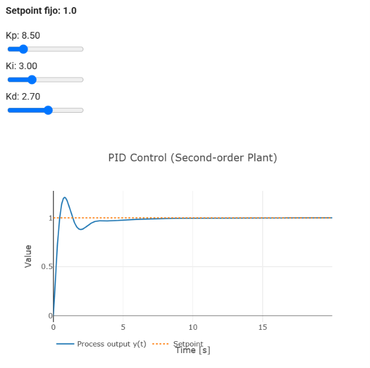
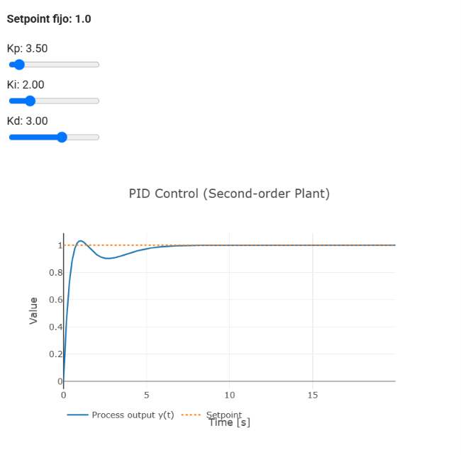

# **Reporte 7: Control**
**Institución:** Universidad Iberoamericana Puebla  
**Materia:** Introducción a la Mecatrónica  
**Tema:** Control: Lazo abierto & PID

## Lista de materiales
- Carro robot con ESP32 y driver de motores. (1x)
- Peso extra de 312.8 g. (1x)

## Parte A: **Lazo Abierto con el carro**

> Los archivos utilizados en la parte A de la práctica son iguales al equipo de Andrea y Fran, ya que se realizo en conjunto. (unicamente en la parte A).

**Código**  
Generamos un código con ayuda de IA, para que, el carro avanzara de forma recta durante 3seg con PWM fijo y se detuviera déspues del tiempo determinado.

```c
/ --- Definición de Pines de tu Driver ---
const int STBY = 23;        // Pin Standby del driver

// Motor A
const int PWMA = 13;
const int AIN1 = 12;
const int AIN2 = 14;

// Motor B
const int PWMB = 25;
const int BIN1 = 27;
const int BIN2 = 26;

void setup() {
  Serial.begin(115200);

  // Configurar pines como salida
  pinMode(STBY, OUTPUT);
  pinMode(AIN1, OUTPUT);
  pinMode(AIN2, OUTPUT);
  pinMode(BIN1, OUTPUT);
  pinMode(BIN2, OUTPUT);

  // Activar el driver (sacarlo de standby)
  digitalWrite(STBY, HIGH);

  // Configurar PWM en el ESP32 (Frecuencia 1 kHz, resolución 8 bits)
  ledcAttachChannel(PWMA, 1000, 8, 0); // Canal 0
  ledcAttachChannel(PWMB, 1000, 8, 1); // Canal 1

  Serial.println("Iniciando prueba: Avanzando por 3 segundos...");

  // 1. Definir dirección de avance para ambos motores
  digitalWrite(AIN1, HIGH);
  digitalWrite(AIN2, LOW);
  digitalWrite(BIN1, HIGH);
  digitalWrite(BIN2, LOW);

  // 2. Enviar potencia PWM a los motores (velocidad 200 de 255)
  ledcWrite(PWMA, 200);
  ledcWrite(PWMB, 200);

  // 3. Mantener el movimiento exactamente durante 3000 ms (3 segundos)
  delay(3000);

  // 4. Detener los motores por completo
  ledcWrite(PWMA, 0);
  ledcWrite(PWMB, 0);
  digitalWrite(STBY, LOW); // Poner driver en modo paro

  Serial.println("¡Tiempo cumplido! Carro detenido.");
}

void loop() {
  // Se deja vacío para que la secuencia no se repita.
}
```

**Peso utilizado**  
{ width=70% } <br>
Con ayuda de un muñeco, logramos alcanzar en peso requerido para las pruebas: 312.8g <br>

**Demostración de la práctica**  
[Piso 1 sin peso](../img/1_xpeso..mp4)  
[Piso 1 con peso](../img/1_peso.MP4)  
[Piso 2 sin peso](../img/2_xpeso.MP4)  
[Piso 2 con peso](../img/2_peso.mp4)  

**Resultados**  
Distancia recorrida en 3s , según el peso y la carga.  

| Condición | Intento | Distancia recorrida (cm) | Observaciones |
| --- |  --- | --- | --- |
| Piso liso **(sin peso)** | 1 | 108 | El carro no avanzo en linea recta por la rueda loca |
| Piso liso **(con peso)** | 2 | 96 | Se desplazo más lento con el peso y se desvió hacia la derecha el carro |
| Piso rocoso **(sin peso)** | 1 | 111 | Gracias a las rocas el carro avanzó en línea recta |
| Piso rocoso **(con peso)** | 2 | 105 | Al desplazarse más lento el carro, recorre menos distancia en el mismo tiempo |


## Parte B: **Lazo cerrado con la demo**

| Intento | kp | ki | kd | Sobreimpulso (%) | Tiempo de establecimineto (s) | Error permanente | Observación |
| --- | --- | --- | --- | --- | --- | --- | --- |
| 1 | 8.50 | 0 | 0 | 62 | No se establece en la banda |0.11 | Sube rápido y pasa el valor de 1, luego oscila y se estabiliza en 0.89 | 
| 2 | 8.50 | 0 | 2.70 | 15 | No se establece en la banda | 0.11 | Sobrepasa un poco de 1, pero casi no oscila se estabilizo en 0.89 |
| 3 | 8.50 | 3.00 | 2.70 | 20 | 3 | 0 | La gráfica sube rapido pasandose un poco de 1, baja y luego llega a 1 sin oscilar, eliminando el error permanente |

**Parámetros finales** 

- ***Kp = 8.5 ->*** Se seleccionó porque la curva reaccionaba de forma rápida, aunque provocó muchas oscilaciones (sobreimpulso de 62%).  
- ***Kd = 2.7 ->*** Amortigua las oscilaciones sin hacerla nerviosa (bajo el sobre impulso de 62% a 15%); no corrigió el error permanente, solo las oscilaciones.  
- ***Ki = 3 ->*** Eliminó el error permanente, aunque el sobreimpulso pasó de 15% a 20%.  

<div style="display: flex; gap: 10px;">
  <div style="flex: 1; text-align: center;">
    
    <p>Gráfica: intento 1</p>
  </div>
  <div style="flex: 1; text-align: center;">
    
    <p>Gráfica: intento 2</p>
  </div>
</div>
 
{width=50%} <br> Gráfica: intento 3 </br>

## Extra: **Encontrar valores**
Ajuste de la demo con sobreimpulso menor a 5 % y tiempo de establecimiento menor a 5 s.

**Intentos**

| # intento | kp | ki | kd | Sobreimpulso (%) | Tiempo de establecimineto (s) | Error permanente | Observación |
| --- | --- | --- | --- | --- | --- | --- | --- |
| 1 | 8.50 | 1.70 | 3.00 | 15 | 5 (límite) | 0 | No se cumple ni el sobreimpulso ni el tiempo de establecimiento |
| 2 | 4.00 | 1.70 | 3.00 | 4 | 5 (límite) | 0 | Se cumple el sobreimpulso pero seguiamos en el limite del tiempo de establecimiento |
| 3 | 3.5 | 2.00 | 3.00 | 3 | 4.6 | 0 | Se redujo más el sobreimpulso y el tiempo de establecimiento, logrando el objetivo |

<div style="display: flex; gap: 10px;">
  <div style="flex: 1; text-align: center;">
    
    <p>Intento 1</p>
  </div>
  <div style="flex: 1; text-align: center;">
    
    <p>Intento 2</p>
  </div>
</div>

{width=50%} <br> Intento 3 </br> 

## Conclusión
En la parte A se demuestra que el peso y el tipo de piso si afectan el desempeño del carro: con el mismo PWM y el tiempo recorrido; además al ser un lazo abierto no se pueden corregir las perturbaciones.  
En la parte B, se comprobo que cada parte del PID cumple una función diferente: *P* da rápides, *D* amortigua osicilaciones e *I* elimina el error permanente. Sintonizarlo requiere un equilibrio entre rápidez, estabilidad y precisión.

--- 
Tania Hernández Cruz  
Jesús Emiliano Hernández Dóminguez
