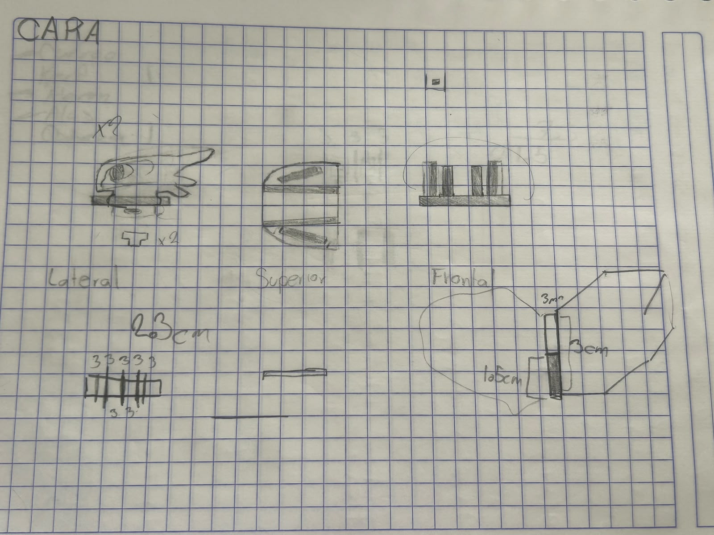
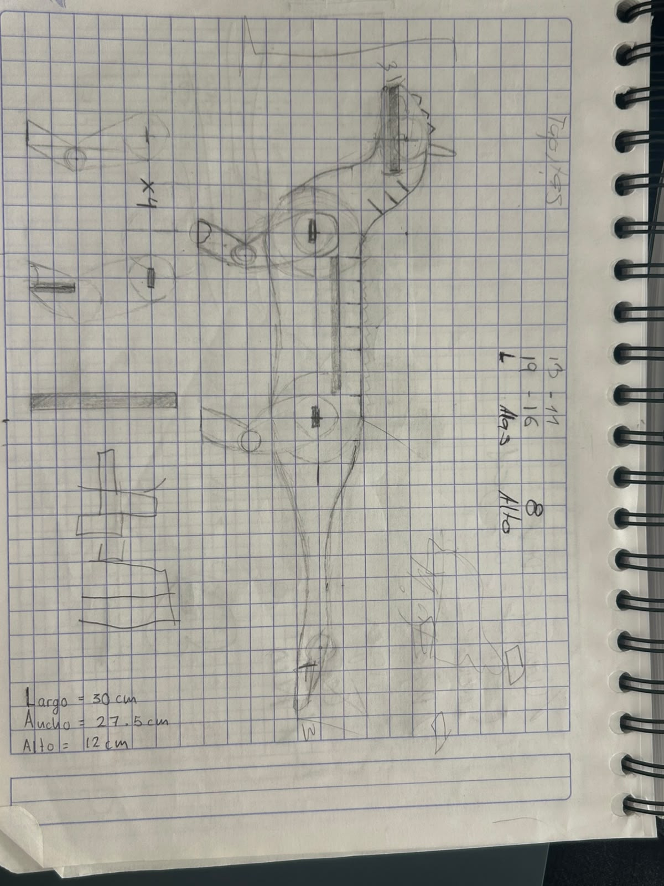
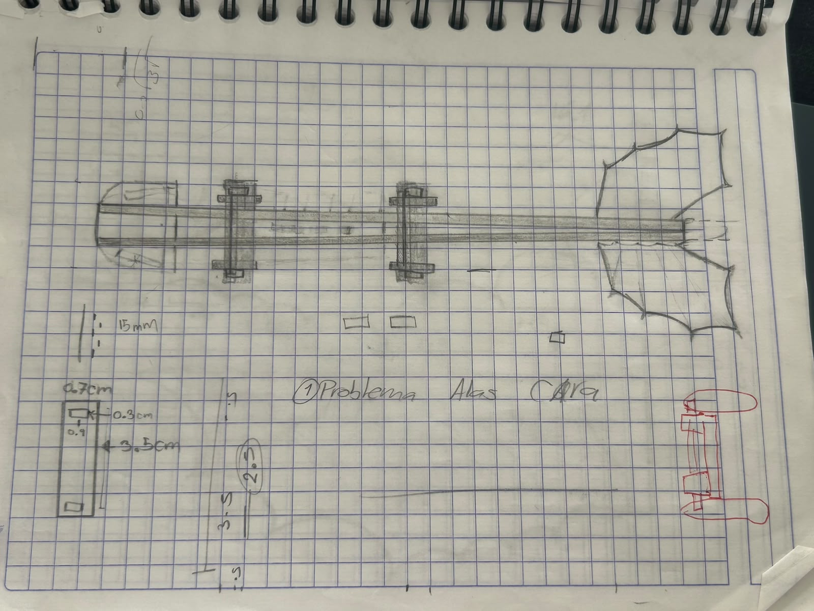
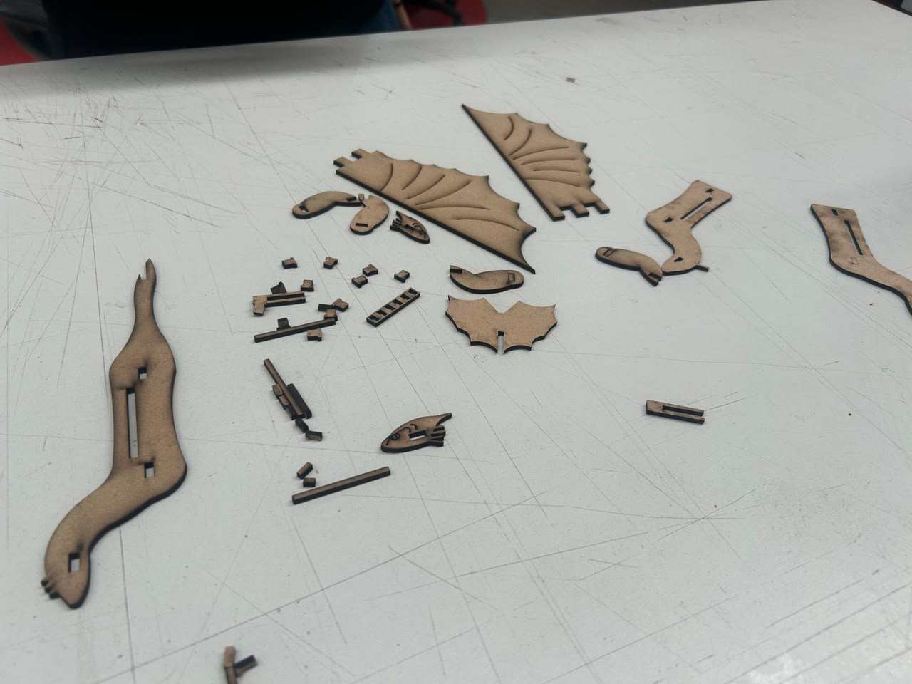
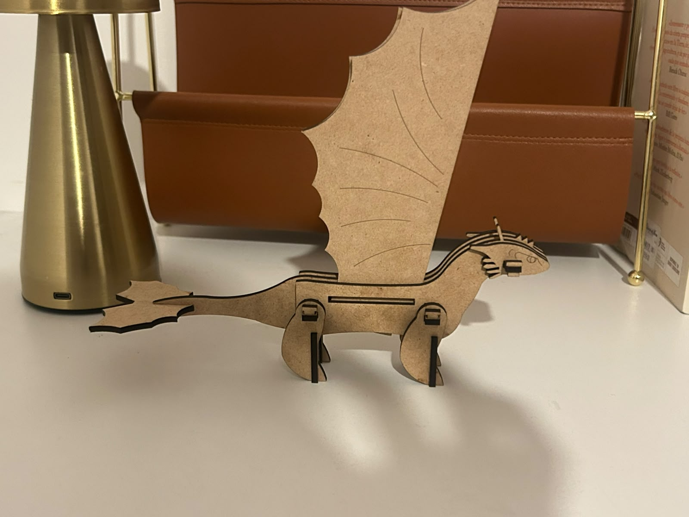

# Reporte de Clase 4

> **Institución:** Universidad Iberoamericana de Puebla  
> **Alumno:** Jesús Emiliano  
> **Tema:** Corte láser (práctica)

---

## 1. Introducción de la Clase

En esta práctica tuvimos que poner en práctica nuestros conocimientos de diseño en SolidWorks, corte láser y creatividad. Mi equipo estaba conformado por Tania y por mí, y decidimos diseñar y fabricar un dragón de MDF al que llamamos Chimuelo.

---

## 2. ¿Cómo ensamblar a tu dragón?

El proceso de diseño y fabricación de nuestro dragón constó de los siguientes pasos:

1. **Búsqueda de referencias:** Primero, buscamos todas las imágenes de referencia posibles para darnos una idea de cómo diseñar nuestro dragón, Chimuelo. Las imágenes que más nos ayudaron fueron las siguientes:

   | Referencia 1 | Referencia 2 |
   | :---: | :---: |
   |  |  |

2. **Bocetado del diseño:** Después, realizamos bocetos en una libreta para definir el diseño de Chimuelo con la mayor claridad posible. Estos dibujos sirvieron como referencia para el modelado, considerando las vistas frontal, lateral y superior.

   | Vista frontal | Vista lateral | Vista superior |
   | :---: | :---: | :---: |
   |  |  |  |

3. **Modelado de las piezas:** A continuación, modelamos cada pieza por separado en SolidWorks, considerando un espesor de 3 mm, correspondiente al material que utilizaríamos. Tomamos como referencia las medidas obtenidas en los bocetos y obtuvimos un total de 27 piezas, distribuidas de la siguiente manera:

   - 1 ala izquierda.
   - 1 ala derecha.
   - 4 patas.
   - 4 soportes para las patas.
   - 1 cuerpo con cola.
   - 2 cuerpos sin cola.
   - 2 caras.
   - 3 vigas de soporte.
   - 1 alerón.
   - 8 piezas de soporte en forma de T.

4. **Verificación del ensamble:** Una vez terminadas todas las piezas, las ensamblamos en SolidWorks para comprobar que las medidas fueran teóricamente adecuadas y evitar que las piezas quedaran flojas o no encajaran correctamente.

5. **Corrección del *kerf*:** Durante el proceso encontramos un problema: no habíamos considerado el *kerf*, que es el ancho de material que elimina el láser durante el corte. Debido a que el haz tiene un ancho distinto de cero, es necesario considerar esta pérdida para obtener las dimensiones deseadas. En nuestro caso, el *kerf* del material fue de 0.22 mm, por lo que tuvimos que ajustar las piezas tomando en cuenta esta medida.

6. **Preparación del archivo para corte:** Después, acomodamos todas las piezas con las correcciones del *kerf* en un dibujo de SolidWorks. Posteriormente, exportamos el archivo en formato `.DXF` y lo abrimos en el programa de la cortadora láser, donde asignamos los parámetros de tiempo y potencia correspondientes al corte y al grabado.

7. **Corte y ensamblaje final:** Finalmente, cortamos las piezas en MDF y las ensamblamos para obtener nuestro dragón terminado, Chimuelo.

   | Piezas cortadas | Dragón ensamblado |
   | :---: | :---: |
   |  |  |

---

## 3. Conclusión

En esta práctica aplicamos los conocimientos adquiridos durante las sesiones anteriores, integrando el diseño en SolidWorks, la preparación de archivos para corte láser y el ensamblaje de piezas. Además, aprendimos la importancia de considerar el *kerf* para obtener un ajuste adecuado entre los componentes.

La actividad fue muy divertida y emocionante, ya que nos permitió transformar un diseño digital en un objeto físico. Finalmente, comprendimos la importancia de planificar y organizar nuestro tiempo, evitando dejar todo para el último momento.