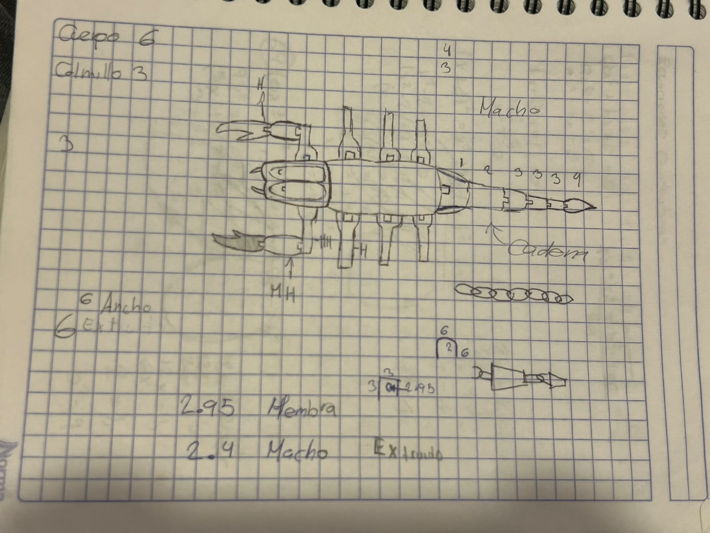
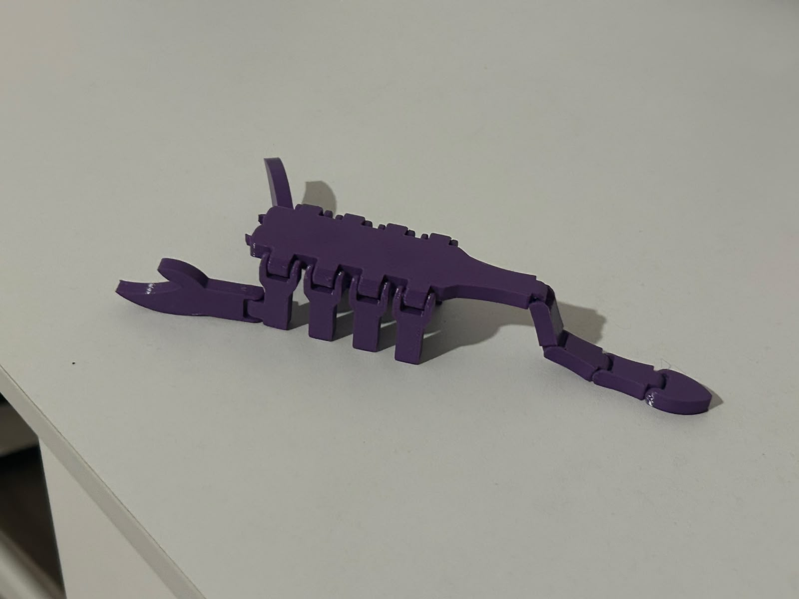

# Reporte de Clase 5

> **Institución:** Universidad Iberoamericana de Puebla  
> **Alumno:** Jesús Emiliano  
> **Tema:** Modelado para Impresión 3D Articulada (Print-in-Place)  

---

## 1. Introducción de la Clase
En esta sesión nos enfocamos en el modelado y la fabricación de piezas mediante impresión 3D articulada, con el objetivo de lograr un diseño que se imprimiera de un solo tirón (Print-in-Place) y que tuviera movilidad inmediatamente al salir de la cama de impresión, sin necesidad de ensamblar partes posteriormente.

---

## 2. Conceptos Clave y Trazado de Geometría
Antes de iniciar con el proyecto individual, el profesor nos enseñó a modelar una cebolla para practicar el manejo de tolerancias y la generación de capas concéntricas.

### Herramienta Principal: Equidistanciar Entidades (Offset)
- **¿Qué es y para qué sirve?** La herramienta **Equidistanciar** (o *Offset*) en SolidWorks permite crear un nuevo trazo a una distancia constante de una geometría o croquis seleccionado.
- **Utilidad en la práctica:** Resulta sumamente útil para este tipo de diseños, ya que permite definir holguras y tolerancias exactas entre las articulaciones, evitando que el plástico fundido se solape y termine soldando las piezas móviles durante la impresión.

---

## 3. Proceso de Diseño y Fabricación
Para el desarrollo individual de la pieza articulada, opté por diseñar un **escorpión**. El procedimiento para llevarlo a cabo fue el siguiente:

1. **Bocetado a mano:** Dibujé el escorpión en mi libreta para estructurar el número de segmentos del cuerpo, la cola y las tenazas.
2. **Conteo de piezas y articulaciones:** Definí la cantidad de eslabones necesarios para garantizar una movilidad fluida.
3. **Modelado y Ensamble en SolidWorks:** Diseñé los eslabones utilizando la herramienta de equidistancia para dejar las tolerancias de movimiento necesarias y verifiqué la estructura dentro del software.
4. **Impresión 3D:** Una vez exportado el archivo, lo mandamos a imprimir en las impresoras 3D del salón del profesor Oliver.

---

## 4. Evidencias del Proyecto

### Boceto Inicial

### Modelado 3D e Impresión
| Ensamble en SolidWorks | Impresión 3D del Escorpión |
| :---: | :---: |
|  |  |

---

## 5. Conclusiones y Aprendizajes
- **Dominio de tolerancias:** Comprendí cómo el uso correcto de la herramienta equidistanciar permite diseñar mecanismos móviles que funcionan desde el momento en que se retiran de la impresora.
- **Optimización de manufactura:** La técnica de impresión en una sola pieza reduce el tiempo de postprocesamiento y elimina la necesidad de pegamentos o pernos de unión.
