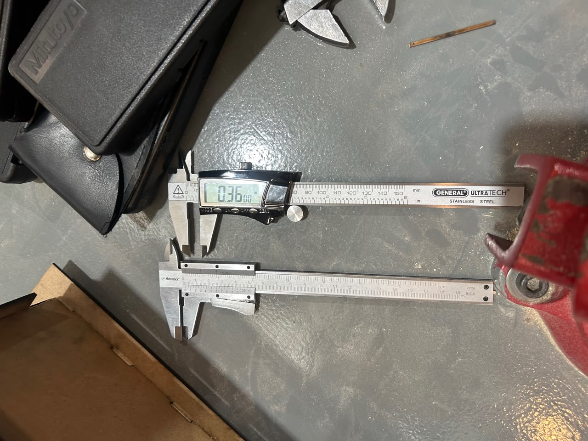
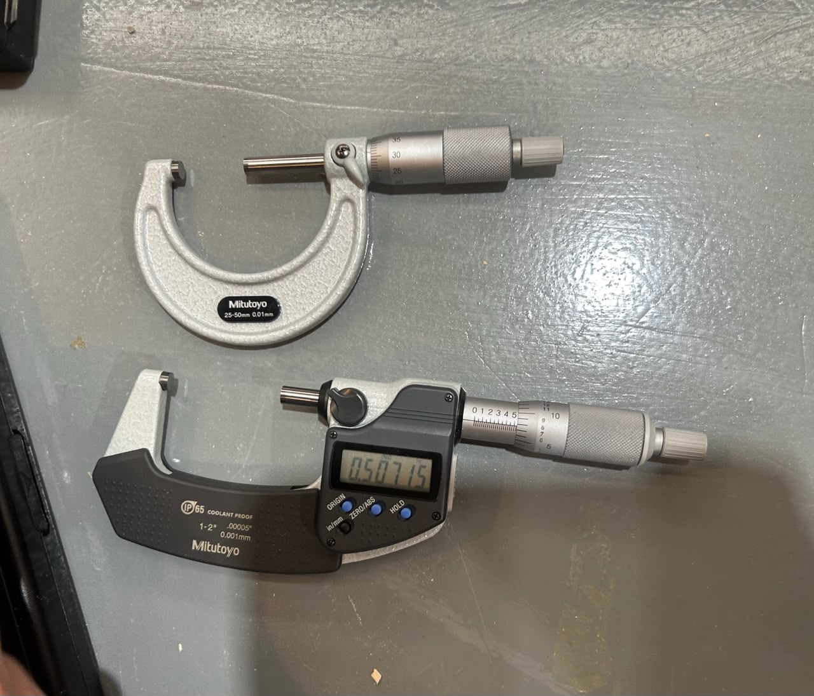
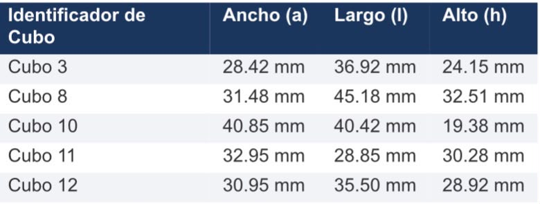
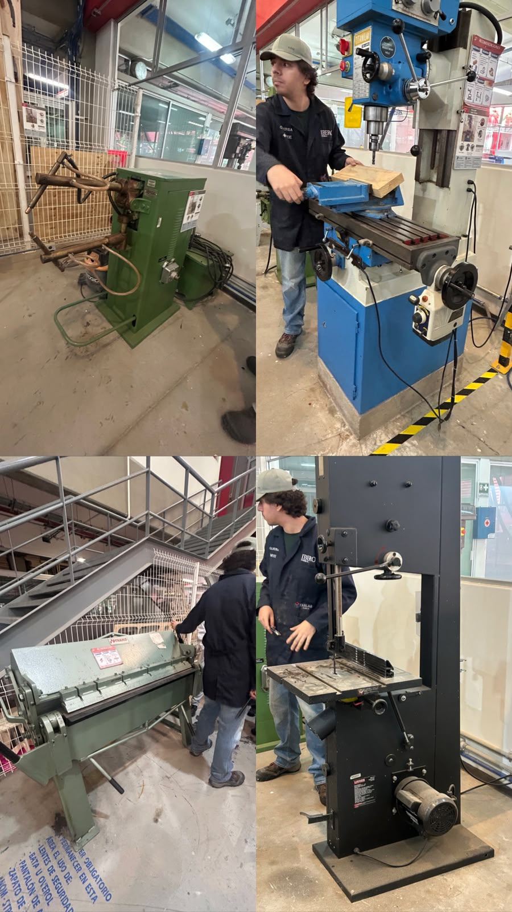

# Reporte de Clase 6

> **Institución:** Universidad Iberoamericana de Puebla  
> **Alumno:** Jesús Emiliano  
> **Tema:** Metrología Dimensional y Herramientas del Taller Mecánico  

---

## 1. Introducción de la Clase
En esta sesión le echamos un ojo al uso de varias herramientas e instrumentos de medición y equipos chidos del taller. Vimos cómo operan las máquinas de manufactura y los aparatos de metrología, y cerramos con una práctica para comparar la precisión entre instrumentos.

---

## 2. Instrumentos y Herramientas del Taller

### Instrumentos de Medición de Precisión
- **Vernier (Digital y Mecánico):** El instrumento clásico para medir exteriores, interiores y profundidades con buen nivel de detalle. El mecánico te pide leer el nonio, mientras que el digital te avienta el número directo en la pantallita LCD.
- **Micrómetro:** Sirve para medir espesores o diámetros muy pequeños con una precisión todavía mayor que la del vernier (llega a medir hasta micras).

### Equipos y Maquinaria del Taller
- **Broca y Fresa:** La broca hace hoyos cilíndricos bajando en el taladro, y la fresa es la que gira en la fresadora para desgastar, ranurar o darle forma al metal.
- **Fresadora:** La máquina encargada de maquinar piezas arrancando viruta con una fresa giratoria.
- **Sierra Cinta:** Usa una banda metálica con dientes continua para cortar perfiles o bloques de metal sin tanto rollo.
- **Corta Láminas (Cizalla):** Para hacer cortes rectos y limpios en láminas delgadas usando palanca o presión.
- **Soldadora por Puntos:** Junta dos láminas metálicas superpuestas aplicándoles presión y un toque de corriente eléctrica intensa justo en el punto que necesitas.
- **Dobladora de Láminas:** Equipo mecánico para doblar la lámina al ángulo exacto que te pidan de forma controlada.

---

## 3. Práctica de Medición Comparativa
Para la parte práctica, el profe Oliver nos puso a medir el largo, alto y ancho de 5 cubos. Hicimos la chamba en dos partes para comparar qué tan cabrona era la diferencia:

1. **Primera medición:** Tomamos las dimensiones de los 5 cubos usando el vernier.
2. **Segunda medición:** Volvimos a medir las mismas cotas pero usando el micrómetro para ver la variación real entre los aparatos.

---

## 4. Evidencias de la Práctica

### Medición e Instrumentos de Medición
| Uso del Vernier | Uso del Micrómetro |
| :---: | :---: |
|  |  |

### Mediciones de Cubos y Equipos del Taller
| Medición de Cubos | Herramientas del Taller |
| :---: | :---: |
|  |  |

---

## 5. Conclusiones y Aprendizajes
- **El nivel de precisión importa:** Comprobamos que el micrómetro es mucho más exacto que el vernier, ideal para cuando andas trabajando con tolerancias bien cerradas donde cualquier milésima te arruina el ensamble.
- **Elegir la herramienta correcta:** Aprendimos a identificar cuál instrumento de medición usar según el nivel de precisión que te pida el proyecto en el taller.