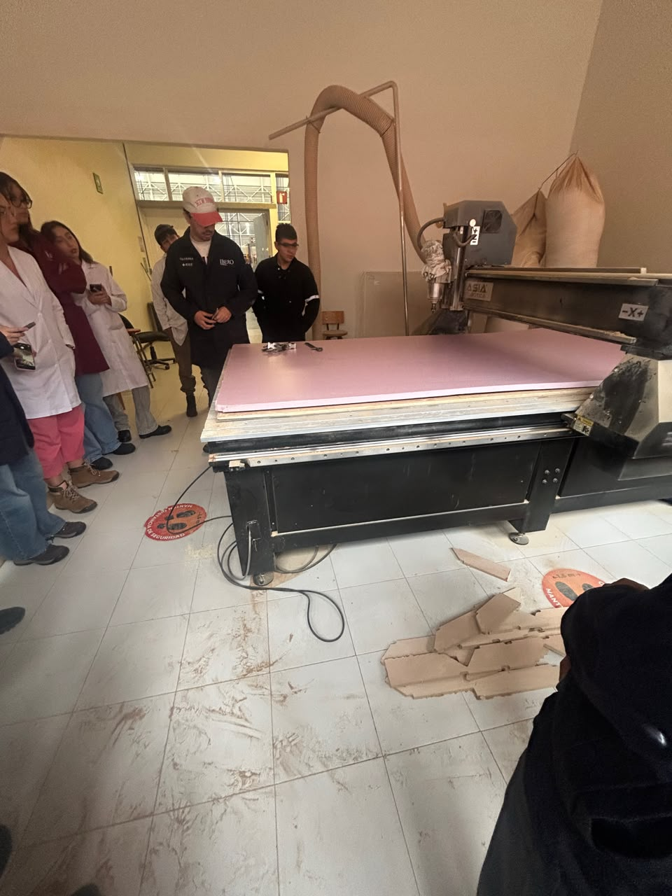
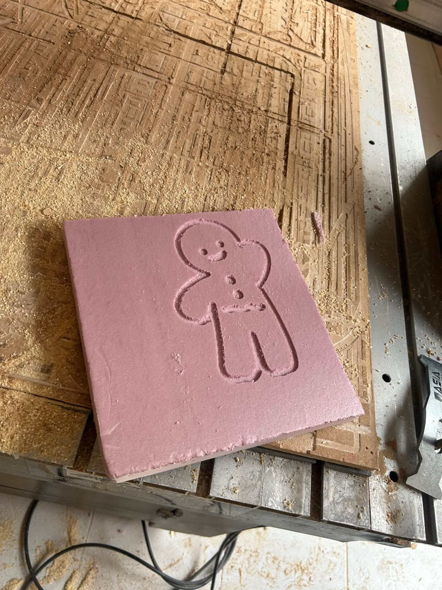

# Reporte de Clase 7

> **Institución:** Universidad Iberoamericana de Puebla  
> **Alumno:** Jesús Emiliano  
> **Tema:** Introducción al Control Numérico Computarizado (CNC) y Código G  

---

## 1. Introducción de la Clase
En esta sesión conocimos cómo jala la **Máquina CNC** (Control Numérico Computarizado), un equipo automatizado que trabaja con 3 ejes ($X, Y, Z$) para hacer cortes y desbastes con un buen nivel de detalle. Antes de entrar al área de maquinado, nos pusimos el equipo de protección de cajón: overol, lentes de seguridad y botas con casquillo.

---

## 2. Comandos y Fundamentos de Código G
El Código G es el lenguaje que entiende la máquina CNC para saber qué movimientos hacer. Aquí están los comandos principales que revisamos:

| Comando / Variable | Descripción |
| :--- | :--- |
| **G0** | Movimiento rápido, sin mecanizar (para acomodarse). |
| **G1** | Movimiento lineal controlado (para cortar o avanzar chambeando). |
| **G2** | Arco en sentido horario. |
| **G3** | Arco en sentido antihorario. |
| **G17** | Selecciona el plano de trabajo XY. |
| **G21** | Trabajar en milímetros. |
| **G20** | Trabajar en pulgadas. |
| **G90** | Coordenadas absolutas. |
| **G91** | Coordenadas incrementales. |
| **G53** | Cero máquina (referencia de fábrica). |
| **G54** | Cero de pieza / sistema de coordenadas de trabajo. |
| **X, Y, Z** | Posición de los ejes. |
| **F** | Velocidad de avance. |
| **S** | Velocidad del husillo. |
| **M3** | Encender husillo en sentido horario. |
| **M4** | Encender husillo en sentido antihorario. |
| **M5** | Apagar el husillo. |
| **M30** | Finalizar programa y reiniciar. |

---

## 3. Práctica de Maquinado: La Galletita de Shrek
Para la parte práctica hice equipo con mi compañero **Emmanuel**. El reto era elegir un archivo digital para esculpirlo físicamente con la CNC. 

1. **Elegir el diseño:** Buscamos algo divertido y representativo, así que optamos por esculpir la clásica **galletita de jengibre (de Shrek)**.
2. **Checar el código:** Revisamos que las velocidades, la profundidad y el cero de pieza (G54) estuvieran bien puestos para no regarla con el material.
3. **Poner a jalar la máquina:** Agarramos y aseguramos bien el material a la cama de la CNC, activamos los seguros y dejamos que la máquina hiciera lo suyo esculpiendo capa por capa con el código G.

---

## 4. Evidencias del Proyecto

### Operación en la Máquina CNC y Resultado
| Máquina CNC en Funcionamiento | Pieza Final (Galletita de Shrek) |
| :---: | :---: |
|  |  |

---

## 5. Conclusiones y Aprendizajes
- **Entender la automatización:** Ver cómo funciona el Código G está chido porque entiendes cómo puras líneas de texto se convierten en movimientos mecánicos reales en los tres ejes.
- **Calibrar bien es clave:** Aprendimos que poner bien el cero de pieza ($G54$) y ajustar las velocidades ($F$ y $S$) es fundamental para que la pieza salga limpia y no se dañe nada.