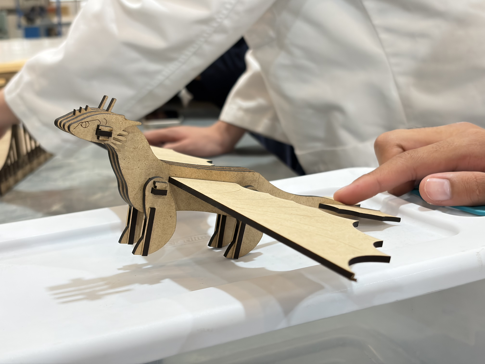

# Corte Láser (Ensamble)

>*11 a 25 de Septiembre*

Para aprender a utilizar la máquina de corte láser, tuvimos que realizar un ensamble con alguno de los joints que aprendimos en clase y con la única restricción de no poder utilizar pegamento o cinta para unir las partes.  
Nuestra propuesta de diseño fue: **Drágon chimuelo**

## **Diseño en SolidWorks** 
Se diseñaron en total: 9 piezas  

- Alas (2)
- Alerón (1)
- Cabeza (2)
- Patas (4)
- Viga (2)
- Uniones t (18)
- Vista frontal patas (4)
- Cuerpo completo (1)
- Cuerpo mitad (2)

  
  
<i>Imagen representativa de como se realizaron las piezas</i>

   

### **Ensamble en Solidworks**
Antes de cortar las piezas, realizamos un ensamble en solidworks para asegurarnos que las piezas encajaran o en caso de que no enecajen poder corregirlo antes de cortar.

  
  
<i> Asi se visualizo nuestro ensamble.</i>

  

Posteriormente de haber realizado el ensamble, acomodamos las piezas en el dibujo (archivo que se manda a la cortadora).  
Ya en el dibujo agregamos la cantidad necesaria de cada pieza, estas se ordenan de tal manera que se pudiera gastar el menor material posible y aprovechando cada espacio.

## **Corte láser**
Subimos el archivo en la aplicación designada para el corte láser, ajustamos en que partes es grabado o corte y mandamos a cortar.

  

    
    
Programa utilizado para el corte.

  

  

    
    
Piezas cortadas.

  

## **Ensamble final**  

Después de el corte, realizamos el ensamble de la figura dando como resultado un ensamble correcto.

