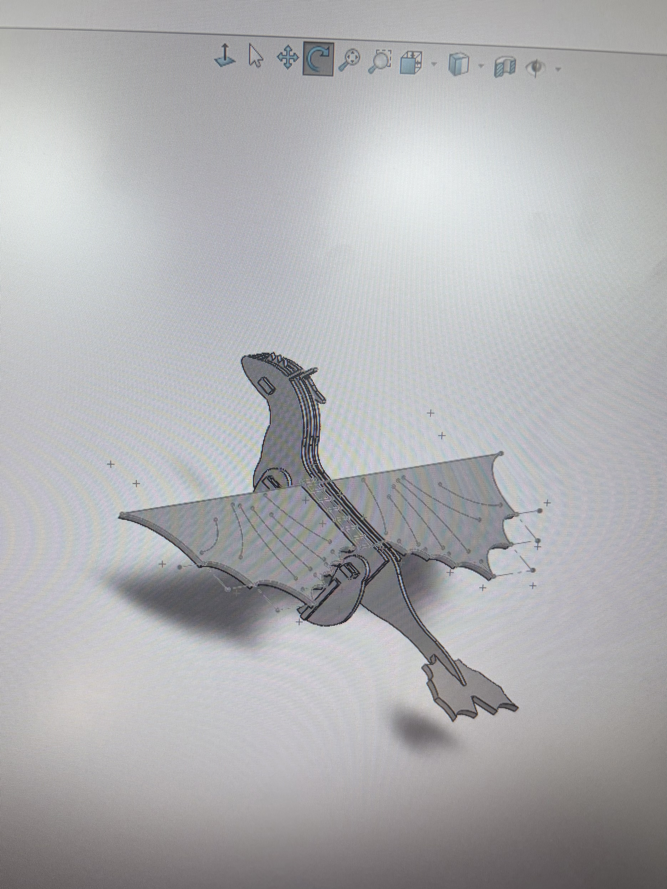

# Corte Láser (Ensamble)

>*11 a 25 de Septiembre*

Para aprender a utilizar la máquina de corte láser, tuvimos que realizar un ensamble con alguno de los joints que aprendimos en clase y con la única restricción de no poder utilizar pegamento o cinta para unir las partes.  
Nuestra propuesta de diseño fue: **Drágon chimuelo**

## Diseño en SolidWorks 
Se diseñaron en total: 9 piezas  
- Alas (2)
- Alerón (1)
- Cabeza (2)
- Patas (4)
- Viga (2)
- Uniones t (18)
- Vista frontal patas (4)
- Cuerpo completo (1)
- Cuerpo mitad (2)

  
  
<i>Imagen representativa de como se realizaron las piezas</i>

   

### **Ensamble en Solidworks**
Antes de cortar las piezas, realizamos un ensamble en solidworks para asegurarnos que las piezas encajaran o en caso de que no enecajen poder corregirlo antes de cortar.
Vista de las piezas en 3d

  
  
<i> E</i>

   

    

