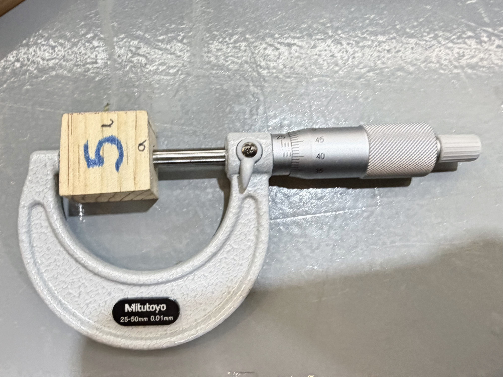

# Máquinas del IDIT (actividad Vernier)

>25 de Septiembre 

En esta clase aprendimos a utilizar algunas máquinas manuales del IDIT, además de el uso del micrómetro y vernier 

## **Instrumentos de medición** 
Para utilizarlo se recomienda:  
1. Limpiar el instrumento antes de medir
2. Verificar que marque cero al estar cerrado 
3. No ejercer presión al medir  

- **Vernier:** Nos permite conocer dimensiones con mayor precisión, este material nos ayuda a medir longuitudes en diámetros exteriores e interiores, profunididades de agujeros 

- **Micrómetro:** Utiliza un mecanismo de tornillo para medir dimensiones pequelas con mayor exactitud; sirve para medir espesores de materiales.

## **Broca y Fresa**
- **Broca:** Tiene una punta puntiaguda que sirve para hacer ***perforaciones***. Tiene filo en los lados por lo que corta circularmente hacia abajo (adentro)  
- **Fresa:** Corta hacia los lados, sirve para ***esculpir***; sirve para volumenes. Por lo general, se utiliza en materiales duros y avanza a la parte que se corta 

*Flauta:* Son los dientes de la fresa/ (¿Cuántos filos tiene?)

## **Fresadora** 

  

    <i>Datos:</i>
    <ul>
      <li>La manija de lado avanza en el eje X.</li>
      <li>La manija de enfrente avanza en el eje Y.</li>
      <li>La broca debe entrar menos del 50% en el material.</li>
      <li>El corte se realiza en el sentido de las manecillas del reloj.</li>
    </ul>
  

  

  
  
<i>

  <i>Pasos para utilizarla:</i>
  <ol>
    <li>Se enciende con el botón rojo y se gira la perilla según las indicaciones del instructor.</li>
    <li>Se libera el paro de emergencia siguiendo el procedimiento indicado.</li>
    <li>Se selecciona el modo de uso.</li>
    <li>Se ajustan las revoluciones por minuto (rpm) necesarias para el corte.</li>
  </ol>

  </i>

  

## **Sierra cinta**

  

    <i>Pasos para utilizarla:</i>
    <ul>
      <li>Colocar el material y sujetarlo con ambas manos.</li>
      <li>En el lado izquierdo se ajusta la posición.</li>
      <li>Sirve para cortas placas o cosas muy delgaditas.</li>
      <li>Hacer perfiles</li>
    </ul>
  

  

## **Corta láminas**
*La máquina corta en diagonal*

  
  
<i>

  <i>Pasos para utilizarla:</i>
  <ol>
    <li>Coloca la lamina en la maquina, procurando que quede debajo de los dientes.  </li>
    <li>Se pisa el pedal , ejerciendo fuerza. </li>
  </ol>

  </i>

  

## **Doblar láminas**

  

    <i>Datos:</i>
    <ul>
      <li>Siempre se debe doblar más de lo que queremos, ya que el material se regresa.</li>
      <li>Al cortar el material se tensa y es dificil revertirlo.</li>
    </ul>
  

  

## **Soldadura por 2 puntos**

  
  
<i>

  <i>Datos:</i>
  <ol>
    <li> Solo es un pequeño piquete de soldadura  </li>
    <li> Se realiza pisando el pedal, delicadamente </li>
  </ol>

  </i>

  

## **Práctica**

| # de cubo | Vernier (*mm*) | Micrómetro (*mm*) |
| --- | --- | --- |
| 2 | a= 36.3   l= 79.56  h= 28.38 | a= 36.32   l= *no se puede medir*   h=28.15 |
| 5 | a= 25.68   l= 28.21  h=23.18 | a= 26.26   l= 28.43   h=*no se puede medir* |
| 6 | a= 32.33   l= 43.28  h= 28.20 | a= 32.2   l= 43.30   h= 28.40 |
| 8 | a= 31.80   l= 45.27  h= 32.49 | a= 32   l= 45.5   h=32.7 | 
| 17 | a= 31.84   l= 41.38  h= 29.45 | a= 32.4   l= 41.58    h=29.65 |

Entre los instrumentos de medición puede existir una diferencia mayor o menor a 1.5mm

