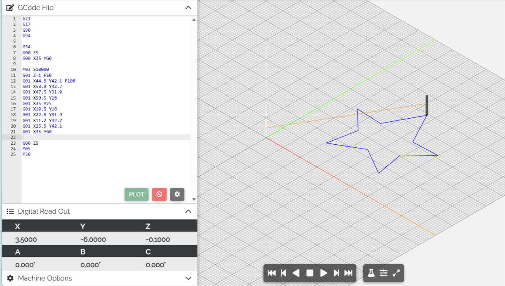
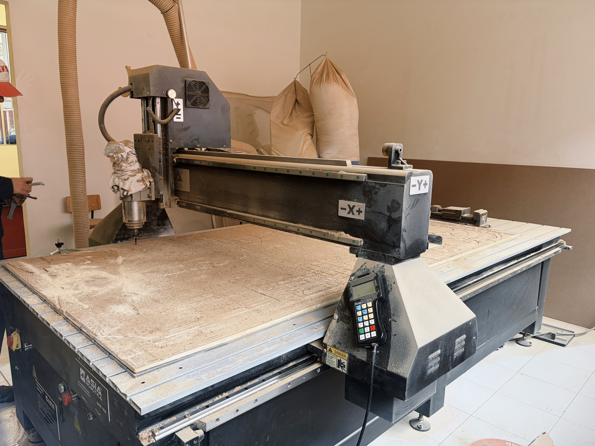
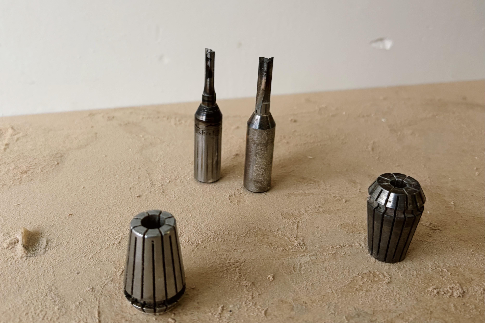

# Máquina CNC
> 2 de Octubre

- Se trabaja en 3 dimensiones  
- Se utiliza equipo de seguridad: Botas, lentes, bata o overol, tapones de oidos.

## **NC viewer**

La siguiente tabla muestra los comandos necesarios para poder realizar figuras en NCviewer:

| Código | Significado | 
|:---:|---|
| G0 | Movimiento rápido, sin mecanizar |
| G1 | Movimiento lineal controlado |
| G2 | Arco en sentido horario |
| G3 | Arco en sentido antihorario |
| G17 | Selecciona plano XY |
| G21 | Trabajar en milímetros |
| G20 | Trabajar en pulgadas |
| G90 | Coordenadas absolutas |
| G91 | Coordenadas incrementales |
| G53 | Cero máquina
| G54 | Cero de pieza / sistema de coordenadas |
| X, Y, Z | Posición de los ejes |
| F | Velocidad de avance |
| S | Velocidad del husillo |
| M3 | Encender husillo horario |
| M4 | Encender husillo antihorario |
| M5 | Apagar husillo |
| M30 | Finalizar programa |

**Práctica**

## **Asia Robotic**

Aprendimos a utilizar la máquina CNC Asia Robotic en la clase, para posteriormente realizar una pieza por nuestra cuenta.

  

    <i>Pasos:</i>
    <ul>
      <li>Encendemos la máquina</li>
      <li>Desactivamos el paro de emergencia </li>
    </ul>
  

  

  
  
<i>

  <ol>
    <li>Ponemos el material sobre la mesa</li>
    <li>Definimos el origen por medio del control</li>
  </ol>

  </i>

  

  

    <ul>
      <li>Aseguramos el material por medio de clams para evitar que salga volando.</li>
    </ul>
  

  

  
  
<i>

  <ol>
    <li>Ajustamos la fresa </li>
  </ol>

  </i>

  

Estas son las piezas por las que esta compuesto el Spindle 

## **Práctica**

Nuestra práctica consistio en realizar un corte en unicel rosa, escogimos una estrella.  
Primero, diseñamos nuestra pieza en *VCarvePro*, donde decidimos que partes serían perfilados (Corte completo) o pocket (grabado).  
Al momento de ir a cortar nuestra pieza, se encontraba ocupada la Asia Robotic, por lo que, utilizamos la máquina roja.   
Ambas funcionan de manera muy similar salvo con unas excepciones como:
- No tiene clamps, se puede martillar o utilizar cinta doble cara en el material.  
- No hay control, se sustituye con un programa llamado *"Asima"* controlado por una computadora.
- Se guarda en un formato diferente (*match*)

Al estar en Asima, abrimos nuestro archivo, verificamos que estuviera bien el origen y se realizo el corte.
Al finalizar, tenemos que limpiar el área que utilizamos.

  

    
    
 Vista del programa utilizado 

  

  

    
    
Resultado final de nuestro corte

  

